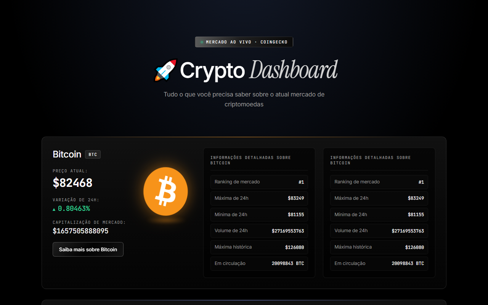

# 🚀 Crypto Dashboard

Painel em React que consome a API pública da CoinGecko e mostra preço, variação de 24h e dados de mercado de **Bitcoin, Ethereum, BNB, XRP e USDC**, com uma janela de história para cada moeda.



**Stack:** React 19 · Vite 8 · CSS puro (sem framework de UI) · oxlint · API REST CoinGecko (sem chave de acesso)

```bash
npm install
npm run dev
```

---

## O que o painel faz

- **Uma requisição para todas as moedas.** O endpoint `/coins/markets?ids=bitcoin,ethereum,...` devolve as cinco moedas de uma vez. Carregamento e erro são estados separados (`loading`, `error`), e cada um tem a sua mensagem na tela.
- **Layout gerado a partir dos dados.** Cada card sai de um `coins.map()`. Para incluir uma moeda nova, basta acrescentar o id na URL, sem escrever JSX novo.
- **Variação de 24h com direção visível.** Uma classe condicional (`up` / `down`) pinta o valor de verde ou vermelho, e um `::before` no CSS acrescenta ▲ ou ▼. O JSX não carrega nenhuma lógica de ícone.
- **Moeda girando em 3D.** O logo vem da própria API (`coin.image`) e gira com `rotateY` + `perspective`, com um brilho na cor da moeda e um reflexo de luz embaixo.
- **Card de detalhes ao lado.** Ranking, máxima e mínima de 24h, volume, máxima histórica e quantidade em circulação, em linhas de rótulo e valor.
- **Janela de história por moeda.** O botão "Saiba mais" abre um modal com o componente daquela moeda. Fecha pelo ✕, pela tecla ESC ou clicando fora da janela.

---

## Decisões técnicas

### 1. Animação em CSS em vez de GIF
O primeiro impulso foi usar um GIF da moeda girando. Troquei por CSS aplicado ao logo que a API já entrega. Assim não existe nenhum arquivo de imagem no repositório, a moeda fica nítida em qualquer tamanho, e qualquer moeda adicionada depois já gira com o próprio logo, sem trabalho manual.

### 2. Uma variável CSS controla a identidade visual de cada moeda
```css
.coin-bitcoin  { --coin: 247, 147, 26; }
.coin-ethereum { --coin: 130, 150, 255; }
```
A cor é guardada como os três números RGB, e não como hexadecimal, para poder ser usada com opacidades diferentes: `rgba(var(--coin), 0.8)` na linha de luz do topo, `0.45` na borda ao passar o mouse, `0.55` no brilho da moeda. Brilho, borda, reflexo, botão e modal leem a mesma variável. Dar uma cor a uma moeda nova custa uma linha.

### 3. O estado guarda só o id
```jsx
const [moedaAberta, setMoedaAberta] = useState(null);
const moedaSelecionada = coins.find((coin) => coin.id === moedaAberta);
```
O modal precisa do nome, do logo e do símbolo da moeda, mas o estado guarda apenas o id. O resto vem da lista `coins`, que continua sendo a única fonte dos dados. Não existe uma segunda cópia do objeto que possa ficar desatualizada.

### 4. Um mapa liga cada id ao seu componente
```jsx
const historias = {
  bitcoin: <Bitcoin />,
  ethereum: <Ethereum />,
  'usd-coin': <USDC />,
  // ...
};
// no modal:
{historias[moedaAberta]}
```
O mapa substitui uma cadeia de `if` ou `switch`. As chaves são os mesmos ids da API, então os dados do mercado e o conteúdo escrito à mão se conectam sem nenhuma conversão.

### 5. O modal limpa tudo o que abre
```jsx
useEffect(() => {
  if (!moedaAberta) return;
  window.addEventListener('keydown', fecharComEsc);
  document.body.style.overflow = 'hidden';
  return () => {
    window.removeEventListener('keydown', fecharComEsc);
    document.body.style.overflow = '';
  };
}, [moedaAberta]);
```
- O listener de ESC só existe enquanto o modal está aberto, e o cleanup do `useEffect` remove o listener quando ele fecha. Nada fica acumulando a cada abertura.
- O efeito também trava a rolagem da página que fica atrás e a destrava no mesmo cleanup.
- O clique no fundo escuro fecha o modal. Dentro da janela, um `stopPropagation` impede que esse clique chegue ao fundo.

### 6. Responsividade sem reescrever o layout
- Os cards usam `flex-wrap` com `flex-basis`: as colunas descem sozinhas quando falta espaço.
- A área de informações é um CSS Grid. A moeda girando ocupa a segunda coluna em todas as linhas (`grid-row: 1 / span 4`), o que a coloca ao lado dos textos sem nenhum `div` extra no JSX.

---

## Como o projeto evoluiu

- **Começou com um único fetch do Bitcoin.** Depois virou uma lista renderizada com `map`, e foi aí que o layout passou a ser gerado pelos dados.
- **Testei incluir a Nvidia.** A CoinGecko só lista criptoativos, e a opção disponível era uma versão tokenizada da ação (NVDAX). O preço acompanhava a ação, mas a capitalização de mercado e o ranking eram os do token (cerca de US$ 45 milhões), e não os da empresa. Mostrar esses números ao lado dos dados de cripto seria enganoso, então removi a Nvidia e mantive o painel focado em cripto.
- **A primeira versão da história usava um array de moedas abertas** (`moedasAbertas` com uma função de abrir e fechar), pensada para expandir vários cards ao mesmo tempo. Troquei por um modal que mostra uma moeda por vez: a leitura fica concentrada num lugar só, e o estado ficou mais simples, de uma lista de ids para um id ou `null`.
- **O visual foi inspirado num template de landing page de produto de IA:** fundo preto, tons prateados, bordas finas, tipografia Inter com detalhes em Instrument Serif itálica. Adaptei para o universo cripto com uma grade de fundo em referência à blockchain, números em fonte mono como num terminal de trading, um indicador "ao vivo" pulsando e uma cor de destaque por moeda.

---

## Estrutura

```
src/
├── App.jsx            # busca dos dados, cards, estado e lógica do modal
├── index.css          # tema, variáveis por moeda, animações, responsividade
└── components/        # um componente de história por moeda
    ├── Bitcoin.jsx
    ├── Ethereum.jsx
    ├── BNB.jsx
    ├── XRP.jsx
    └── USDC.jsx
```

---

## Próximos passos

- [ ] Escrever o conteúdo de história de cada moeda (os componentes estão criados, ainda sem conteúdo)
- [ ] Formatar valores com `Intl.NumberFormat` (`$1.657.505.888.095` → `$1,66 tri`)
- [ ] Atualizar os preços automaticamente com `setInterval` e cleanup no `useEffect`
- [ ] Buscar a descrição e a data de criação no endpoint `/coins/{id}` só quando o modal abrir
- [ ] Extrair um componente `CoinCard` e um hook `useCoins()` para tirar a busca de dados do `App`
- [ ] Gráfico de preço dos últimos 7 dias
